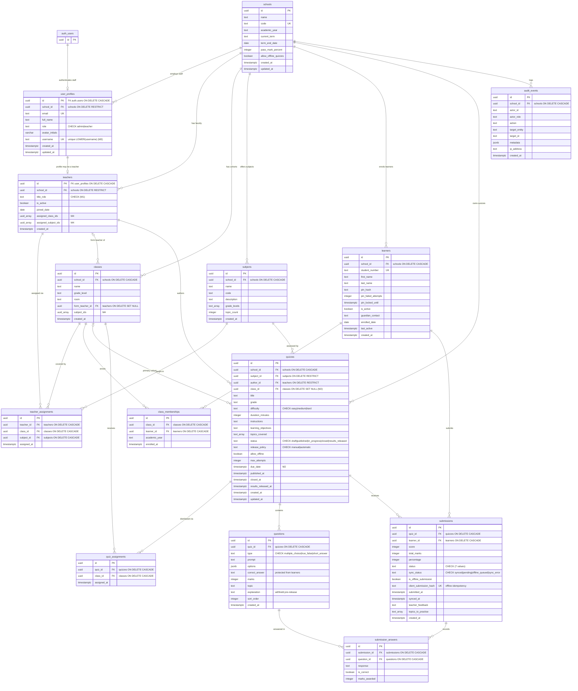

# Database ER Diagram — Growing Minds Academy AI Quiz System

Entity-relationship diagram for the 14 `public` tables produced by
`supabase/migrations/20261020000001_initial_schema.sql` and the four additive
migrations. Primary keys (`PK`), foreign keys (`FK`) and unique constraints
(`UK`) are marked; column names match the migrations exactly.

> **Legend**
> - `pk` = primary key, `fk` = foreign key, `uk` = unique constraint.
> - Cardinality: `||` = exactly one, `o|` = zero or one, `o{` = zero or more,
>   `|{` = one or more.
> - `auth_users` is the Supabase-managed `auth.users` table (external, not one of
>   the 14 application tables) — shown only to anchor the staff-profile link.
> - `uuid_array` = PostgreSQL `UUID[]` (M4 directory associations);
>   `text_array` = PostgreSQL `TEXT[]`.

## Relationship summary

| Parent | Child | Cardinality | FK column | ON DELETE |
|---|---|---|---|---|
| `auth.users` | `user_profiles` | 1 : 0..1 | `id` | CASCADE |
| `schools` | `user_profiles` | 1 : 0..N | `school_id` | RESTRICT |
| `user_profiles` | `teachers` | 1 : 0..1 | `teachers.id` | CASCADE |
| `schools` | `teachers` | 1 : 0..N | `school_id` | RESTRICT |
| `schools` | `classes` | 1 : 0..N | `school_id` | CASCADE |
| `teachers` | `classes` (form teacher) | 0..1 : 0..N | `form_teacher_id` | SET NULL |
| `schools` | `subjects` | 1 : 0..N | `school_id` | CASCADE |
| `teachers` | `teacher_assignments` | 1 : 0..N | `teacher_id` | CASCADE |
| `classes` | `teacher_assignments` | 1 : 0..N | `class_id` | CASCADE |
| `subjects` | `teacher_assignments` | 1 : 0..N | `subject_id` | CASCADE |
| `schools` | `learners` | 1 : 0..N | `school_id` | CASCADE |
| `classes` | `class_memberships` | 1 : 0..N | `class_id` | CASCADE |
| `learners` | `class_memberships` | 1 : 0..N | `learner_id` | CASCADE |
| `schools` | `quizzes` | 1 : 0..N | `school_id` | CASCADE |
| `subjects` | `quizzes` | 1 : 0..N | `subject_id` | RESTRICT |
| `teachers` | `quizzes` (author) | 1 : 0..N | `author_id` | RESTRICT |
| `classes` | `quizzes` (primary cohort) | 0..1 : 0..N | `class_id` | SET NULL |
| `quizzes` | `quiz_assignments` | 1 : 0..N | `quiz_id` | CASCADE |
| `classes` | `quiz_assignments` | 1 : 0..N | `class_id` | CASCADE |
| `quizzes` | `questions` | 1 : 0..N | `quiz_id` | CASCADE |
| `quizzes` | `submissions` | 1 : 0..N | `quiz_id` | CASCADE |
| `learners` | `submissions` | 1 : 0..N | `learner_id` | CASCADE |
| `submissions` | `submission_answers` | 1 : 0..N | `submission_id` | CASCADE |
| `questions` | `submission_answers` | 1 : 0..N | `question_id` | CASCADE |
| `schools` | `audit_events` | 1 : 0..N | `school_id` | CASCADE |

## UNIQUE / composite constraints shown

- `schools.code`
- `user_profiles.email`; partial unique `LOWER(username)` (M3)
- `learners.student_number`
- `classes (school_id, name)`
- `subjects (school_id, code)`
- `teacher_assignments (teacher_id, class_id, subject_id)`
- `class_memberships (class_id, learner_id, academic_year)`
- `quiz_assignments (quiz_id, class_id)`
- `submissions.client_submission_hash`
- `submission_answers (submission_id, question_id)`

See `docs/DATABASE.md` for full column types, CHECK constraints, defaults, the
`learner_active_quiz_questions` view, and the RLS policy inventory.
